# Pj1 — Sistem Persepsi K3/APD

**Deteksi masker, kacamata, dari kamera dengan YOLO**

`Team Cluster 7` · `RET503 (Minggu 4–7)` · `Raspberry Pi 5` · `Logitech C270` · `Ultralytics YOLO`

Sistem ini memeriksa apakah seseorang memakai **masker (`mask`)**, **kacamata (`glasses`)**, dan **sarung tangan (`gloves`)** dari kamera. Perangkat target adalah Raspberry Pi 5 dengan webcam Logitech C270. Repositori ini memuat dataset projek, tiga eksperimen YOLO (E1, E2, E3), hasilnya, dan analisisnya.

---

## Daftar Isi

1. [Ringkasan Hasil](#1-ringkasan-hasil)
2. [Isi Repositori](#2-isi-repositori)
3. [Lingkup Persepsi dan Pipeline](#3-lingkup-persepsi-dan-pipeline)
4. [Data (Tahap 1–2)](#4-data-tahap-12)
5. [Eksperimen (Tahap 3)](#5-eksperimen-tahap-3)
6. [Pemilihan Model dan Hasil Test (Tahap 4–5)](#6-pemilihan-model-dan-hasil-test-tahap-45)
7. [Analisis (Tahap 6)](#7-analisis-tahap-6)
8. [Uji di Raspberry Pi dan Pengembangan Lanjutan](#8-uji-di-raspberry-pi-dan-pengembangan-lanjutan)
9. [Cara Menjalankan Ulang](#9-cara-menjalankan-ulang)

---

## 1. Ringkasan Hasil

| Indikator | Nilai | Keterangan |
|-----------|-------|------------|
| Model terpilih | **E3_tuning** (`yolo26n.pt`, `imgsz=640`) | mAP50-95 val tertinggi |
| mAP50-95 (val) | **0.504** | Angka yang paling mewakili kinerja umum |
| mAP50 (test) | 0.995 | Hanya 20 foto, cenderung optimistis |
| mAP50-95 (test) | 0.796 | Tanpa kelas `gloves` |
| Manfaat transfer learning | **+0.153** mAP50-95 (E1 0.491 vs E2 0.338) | Bobot COCO sangat membantu |
| Uji Raspberry Pi 5 (E3) | **8/8 status benar**, rata-rata **±5,0 FPS** | Uji cepat: satu orang, satu sesi, 100 frame per kondisi |
| Biaya `imgsz` 640 | **±1,9× lebih lambat** (4.6 ms vs 2.4 ms di T4) | Untuk selisih mAP50-95 hanya 0.013 |

> **Catatan:** angka test sangat tinggi karena datanya kecil dan berasal dari sesi kamera yang sama dengan data latih. Gunakan angka **val** sebagai acuan kinerja umum.

---

## 2. Isi Repositori

| Tahap | Yang dikumpulkan | Lokasi |
|-------|------------------|--------|
| 1–2 | Data projek mahasiswa | `data_projek/` (foto webcam sendiri, label YOLO, `data.yaml`, statistik) dan bagian [Data](#4-data-tahap-12) |
| 3 | Hasil E1 dan E3, `results.png` kedua eksperimen | `hasil/E1_pretrained/`, `hasil/E3_tuning/` (E2 di `hasil/E2_scratch/`) |
| 4–6 | `hasil_praktik_Cluster 7.txt/.csv`, analisis, hasil test | `hasil_praktik_Cluster 7.txt`, `.csv`, dan README ini |
| – | Hasil uji Raspberry Pi 5 | `hasil_uji_pi/` (`hasil_uji_pi_e3.txt/.csv` dan 4 foto hasil deteksi) |
| – | Kode | `kode/` (`latih_bandingkan.py` menjalankan E1–E3) |

---

## 3. Lingkup Persepsi dan Pipeline

- **Misi:** memberi status per orang untuk tiga item APD: *sudah / belum / tidak terlihat*.
- **Kamera dan perangkat:** webcam Logitech C270 (640×480) ke Raspberry Pi 5, hanya vision.

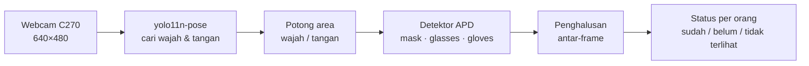

Eksperimen E1–E3 melatih **detektor APD** (komponen inti), bukan keseluruhan pipeline. Penjelasan sistem lengkap ada di [`kode/README_sistem.md`](kode/README_sistem.md).

---

## 4. Data (Tahap 1–2)

### 4.1 Data sendiri

200 foto dari webcam C270, dilabeli kotak YOLO untuk 3 kelas dengan `kode/label_tool.py`.

| Kondisi | Jumlah foto |
|---------|:-----------:|
| Masker | 50 |
| Kacamata | 50 |
| Kacamata hitam + masker | 50 |
| Tanpa APD (contoh negatif) | 50 |

- Pembagian: **140 train · 40 val · 20 test**.
- Pembagian dibuat **berurutan menurut waktu per kondisi** (`make_dataset.py`), bukan acak, agar foto beruntun yang hampir kembar tidak bocor dari train ke val/test.
- Foto sendiri **belum memuat sarung tangan**; kelas itu dipelajari model hanya dari data publik.

| Masker saja | Kacamata saja | Kacamata hitam + masker | Tanpa APD |
|:-----------:|:-------------:|:-----------------------:|:---------:|
| 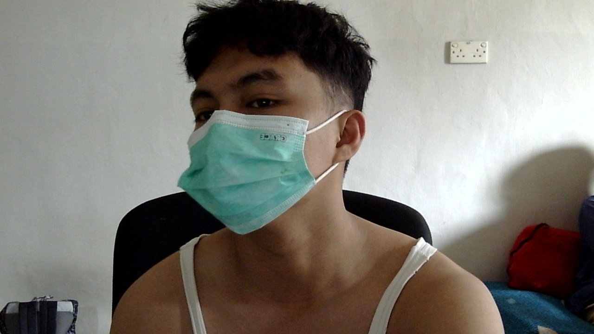 | 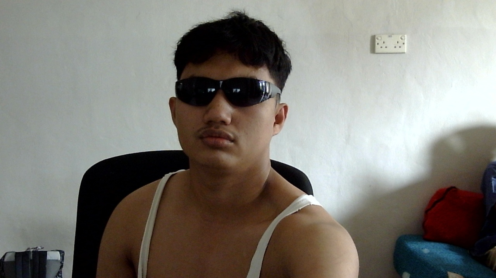 | 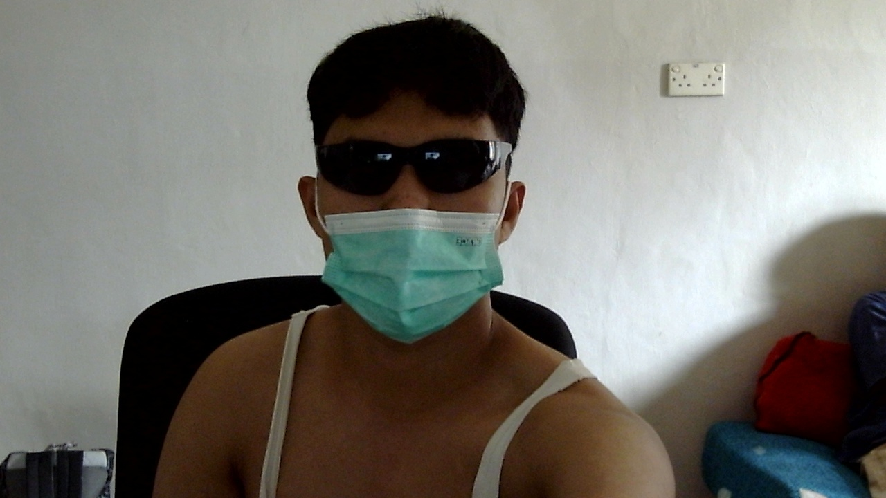 | 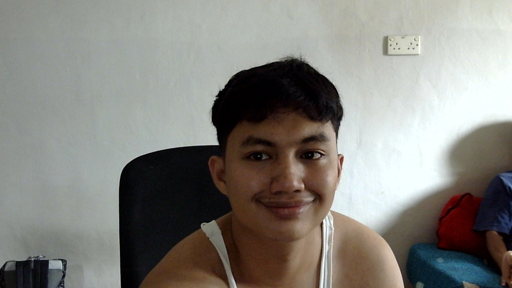 |

*Gambar 4.1 Contoh foto webcam Logitech C270 untuk keempat kondisi (split test).*

### 4.2 Data publik (pelengkap)

- Dataset PPE format YOLOv8 (`PPE Detection_DATA.v3-ppe_dataset_6-class`), diunduh dari Hugging Face `Nexus3/yolov8n-ppe-detection-6classes`. Ketentuan lisensi mengikuti halaman dataset tersebut.
- Kelas dipetakan ke tiga kelas kita dengan `kode/remap_public.py` (kelas lain dibuang): **3507 gambar train** dan **804 gambar val**.
- Data publik **tidak disertakan** di repositori ini.

### 4.3 Dataset yang dipakai eksperimen (`data_gabungan.yaml`)

| Split | Komposisi | Jumlah gambar |
|-------|-----------|:-------------:|
| train | data publik + foto sendiri **diulang 10×** | – |
| val | 40 foto sendiri + 804 publik | 844 |
| test | 20 foto sendiri | 20 |

Sidik jari label: `c155653c2c4f` (4511 gambar, 4511 file label).

---

## 5. Eksperimen (Tahap 3)

Ketiganya memakai data, epoch (30), batch (16), seed (0), dan augmentasi bawaan yang sama; **hanya satu faktor yang berbeda**. GPU Tesla T4 (Google Colab), Ultralytics 8.4.189.

| Eksperimen | Model | Perubahan | imgsz | mAP50 (val) | mAP50-95 (val) | P | R | ms/gambar (T4) | Latih (menit) |
|------------|-------|-----------|:-----:|:-----------:|:--------------:|:-:|:-:|:--------------:|:-------------:|
| E1_pretrained | `yolo26n.pt` | – (baseline) | 416 | **0.824** | 0.491 | 0.863 | **0.760** | 2.4 | 29.9 |
| E2_scratch | `yolo26n.yaml` | bobot acak | 416 | 0.627 | 0.338 | 0.746 | 0.570 | **2.0** | 29.7 |
| E3_tuning | `yolo26n.pt` | `imgsz=640` | 640 | 0.819 | **0.504** | **0.879** | 0.744 | 4.6 | 39.9 |

Angka mentah per epoch ada di `results.csv`, dan pengaturan lengkap di `args.yaml` pada tiap folder eksperimen.

### 5.1 Hasil per kelas (data val)

| Kelas | E1 mAP50 | E1 mAP50-95 | E2 mAP50 | E2 mAP50-95 | E3 mAP50 | E3 mAP50-95 |
|-------|:--------:|:-----------:|:--------:|:-----------:|:--------:|:-----------:|
| `mask` | 0.823 | 0.449 | 0.610 | 0.268 | 0.821 | **0.461** |
| `glasses` | **0.926** | 0.502 | 0.790 | 0.409 | 0.911 | **0.506** |
| `gloves` | 0.723 | 0.523 | 0.480 | 0.336 | **0.724** | **0.544** |

### 5.2 Grafik latihan

Setiap grafik memuat loss latih/val, precision, recall, mAP50, dan mAP50-95 per epoch (garis oranye putus-putus = kurva halus).

**E1_pretrained** (baseline, bobot COCO, `imgsz=416`)

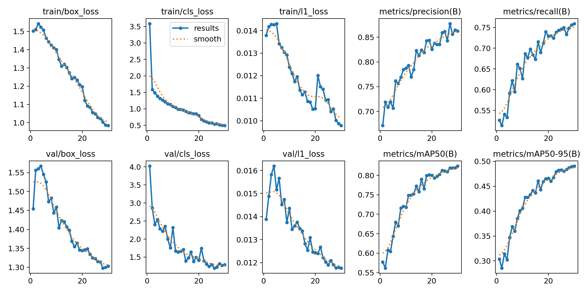

*Gambar 5.1 Grafik latihan E1_pretrained.*

**E2_scratch** (bobot acak, `imgsz=416`)

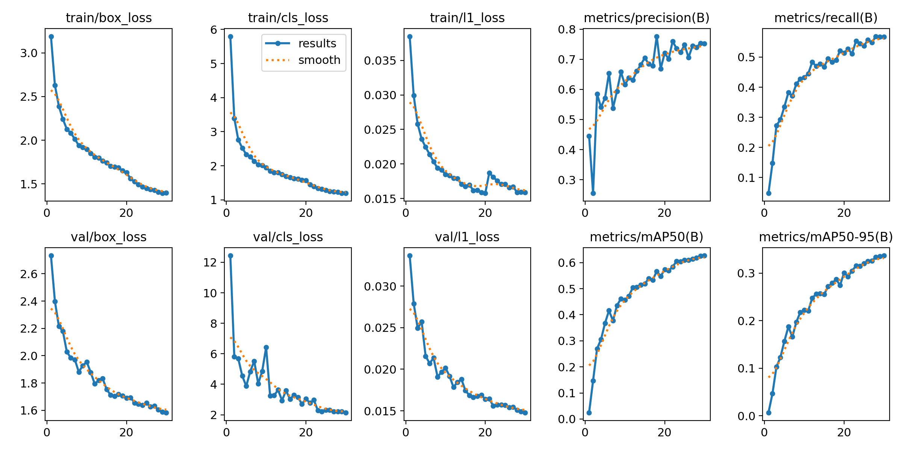

*Gambar 5.2 Grafik latihan E2_scratch. Kurva mulai dari hampir nol dan masih naik di epoch 30.*

**E3_tuning** (bobot COCO, `imgsz=640`)

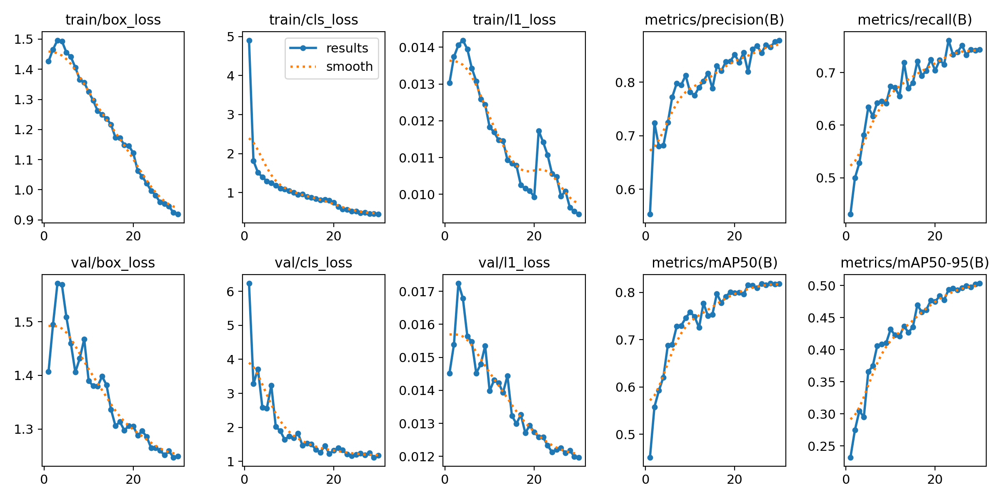

*Gambar 5.3 Grafik latihan E3_tuning. mAP50-95 masih naik di epoch terakhir, yang menandakan model belum konvergen.*

### 5.3 Matriks kebingungan (data val, ternormalisasi)

| E1_pretrained | E2_scratch | E3_tuning |
|:-------------:|:----------:|:---------:|
|  | 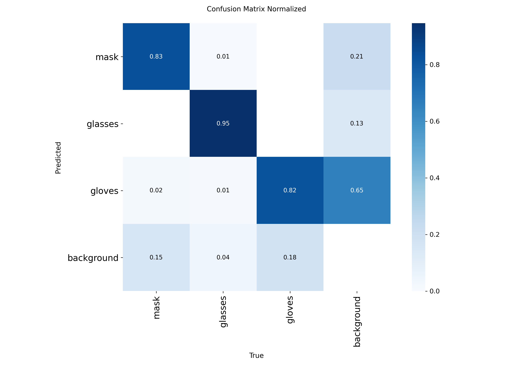 | 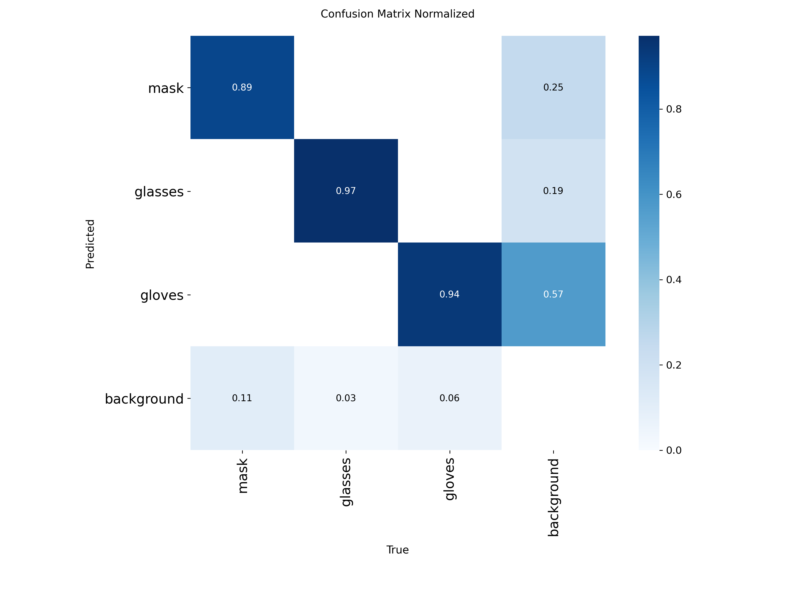 |

*Gambar 5.4 Matriks kebingungan ternormalisasi E1, E2, dan E3. Versi jumlah mentah ada di `confusion_matrix.png` pada tiap folder.*

---

## 6. Pemilihan Model dan Hasil Test (Tahap 4–5)

Model dipilih dari **mAP50-95 val tertinggi**, yaitu **E3_tuning (0.504)**. Data test dipakai **sekali** pada model tersebut.

| Data test (20 foto sendiri) | mAP50 | mAP50-95 | P | R |
|-----------------------------|:-----:|:--------:|:-:|:-:|
| **E3_tuning** | 0.995 | 0.796 | 1.000 | 1.000 |

| Kelas | mAP50-95 (test) |
|-------|:---------------:|
| `mask` | 0.864 |
| `glasses` | 0.729 |

Data test berisi 5 foto per kondisi, termasuk 5 foto **kacamata hitam + masker** (kasus yang sebelumnya gagal). Rincian lengkap: `hasil_praktik_Cluster 7.txt` dan `hasil_praktik_Cluster 7.csv`.

| Matriks kebingungan (jumlah) | Matriks kebingungan (ternormalisasi) |
|:----------------------------:|:------------------------------------:|
| 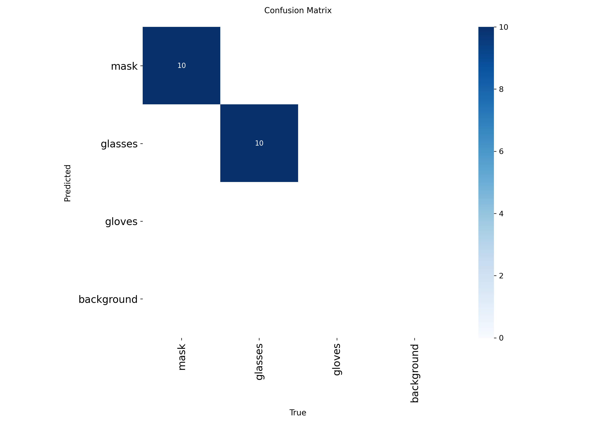 |  |

*Gambar 6.1 Matriks kebingungan model E3_tuning pada data test (`hasil/test_terpilih/`).*

---

## 7. Analisis (Tahap 6)

### 7.1 E1 vs E2 — manfaat transfer learning

Pada epoch yang sama, E1 mencapai mAP50-95 **0.491** sedangkan E2 hanya **0.338** (mAP50 0.824 vs 0.627). Kurva E2 mulai dari hampir nol (0.007 pada epoch 1, sedangkan E1 sudah 0.303) dan masih naik di epoch 30. Bobot COCO memberi pengetahuan awal tentang tepi, bentuk, dan orang, sehingga data kita yang kecil cukup untuk menyesuaikannya. Selisih terbesar ada pada kelas tersulit: sarung tangan (mAP50 0.723 vs 0.480) dan masker (0.823 vs 0.610).

### 7.2 E1 vs E3 — satu langkah tuning (`imgsz` 416 → 640)

E3 menang tipis pada kriteria pemilihan (mAP50-95 0.504 vs 0.491, selisih 0.013), tetapi mAP50 justru sedikit turun (0.819 vs 0.824) dan waktu inferensi naik sekitar **1,9×** (4.6 ms vs 2.4 ms di T4). Karena hanya satu percobaan dengan satu seed, selisih sebesar itu **belum cukup untuk disebut peningkatan yang nyata**.

Gambar yang lebih besar membantu presisi (P 0.879 vs 0.863), terutama untuk masker (P 0.938 vs 0.908), tetapi recall turun sedikit (0.744 vs 0.760).

> Untuk Raspberry Pi yang hanya CPU, kenaikan waktu hitung dua kali lipat itu mahal. **Jika latensi di Pi menjadi batas, E1 pada 416 adalah pilihan yang masuk akal meskipun aturan pemilihan menghasilkan E3.**

### 7.3 Kelas yang lemah

Berdasarkan matriks kebingungan E3 (data val):

| Temuan | Nilai |
|--------|:-----:|
| Kacamata terdeteksi | ≈ 97% |
| Masker terlewat | ≈ 11% |
| Porsi `gloves` dari seluruh alarm palsu | ≈ 57% |

Alarm palsu sarung tangan wajar terjadi karena objek ini mudah mirip tangan, lengan baju, atau benda berwarna gelap. Pada pengamatan langsung sebelumnya (model dari data publik saja), kacamata hitam yang dipakai bersama masker sering tidak terdeteksi; foto sendiri ditambahkan untuk memperbaikinya.

### 7.4 Batasan dan hal yang tidak boleh disimpulkan berlebihan

1. **Angka test (mAP50 0.995) terlalu optimistis.** Hanya 20 foto (10 masker, 10 kacamata), diambil dari kamera dan sesi yang sama dengan foto latih. Angka val (mAP50-95 0.504) lebih mencerminkan kinerja umum.
2. **Data test tidak memuat sarung tangan**, sehingga kinerjanya di data test tidak dapat dilaporkan.
3. **Val didominasi data publik** (804 dari 844 gambar), jadi angka val terutama mengukur data publik, bukan kamera C270.
4. **Satu seed, 30 epoch.** Kurva ketiga eksperimen masih naik di epoch terakhir (E3: 0.475 → 0.503 dari epoch 20 ke 30), jadi model belum konvergen dan ranking E1 vs E3 bisa berubah.
5. Foto sendiri **diulang 10×** di train; ini menaikkan bobot data kamera kita tetapi berisiko menghafal foto-foto tersebut.
6. Data kecil: 200 foto sendiri dan belum ada foto sarung tangan sendiri.

---

## 8. Uji di Raspberry Pi dan Pengembangan Lanjutan

### 8.1 Uji langsung di Raspberry Pi 5

Model terpilih (E3_tuning, berkas `ppe_e3.pt`) diuji pada Raspberry Pi 5 dengan pipeline pose + crop wajah/tangan ([bagian 3](#3-lingkup-persepsi-dan-pipeline)). Satu orang diminta memperagakan empat kondisi, masing-masing diukur selama 100 frame (20 frame pemanasan dibuang).

| Pengaturan | Nilai |
|------------|-------|
| Perangkat | Raspberry Pi 5, Linux 6.18 aarch64 |
| Pustaka | Ultralytics 8.4.185 |
| Model | `ppe_e3.pt` (tag `e3`) |
| `pose-imgsz` / `crop-imgsz` | 320 / 320 |
| Ambang keyakinan (`conf`) | 0.25 |
| Frame per kondisi | 100 (20 frame pemanasan dibuang) |
| Waktu uji | 27 Oktober 2026, 17:58 |

**Hasil per kondisi** (`hasil_uji_pi/hasil_uji_pi_e3.txt` dan `.csv`):

| Kondisi | Item | Dipakai | Benar | Salah | Ragu | FPS |
|---------|------|:-------:|:-----:|:-----:|:----:|:---:|
| Tanpa APD | `mask` | tidak | 100% | 0% | 0% | 4.9 |
| Tanpa APD | `glasses` | tidak | 100% | 0% | 0% | 4.9 |
| Masker saja | `mask` | ya | 100% | 0% | 0% | 5.0 |
| Masker saja | `glasses` | tidak | 100% | 0% | 0% | 5.0 |
| Kacamata biasa saja | `mask` | tidak | 100% | 0% | 0% | 4.9 |
| Kacamata biasa saja | `glasses` | ya | 100% | 0% | 0% | 4.9 |
| Kacamata hitam + masker | `mask` | ya | 100% | 0% | 0% | 5.0 |
| Kacamata hitam + masker | `glasses` | ya | 100% | 0% | 0% | 5.0 |
| **Rata-rata** | | | **100%** | **0%** | **0%** | **5.0** |

*Benar* berarti status sesuai kenyataan, *Salah* berarti kebalikannya, dan *Ragu* berarti status "tidak terlihat", "memeriksa", atau tidak ada orang.

| Tanpa APD | Masker saja | Kacamata saja | Kacamata hitam + masker |
|:---------:|:-----------:|:-------------:|:-----------------------:|
| 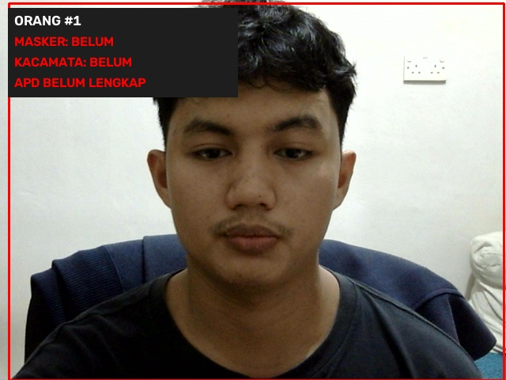 | 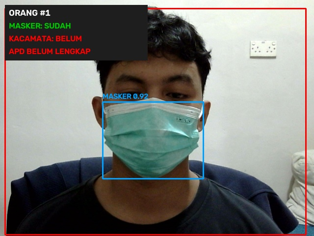 | 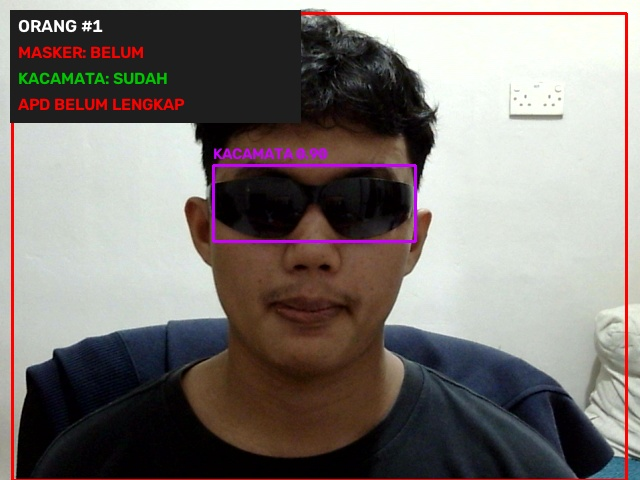 | 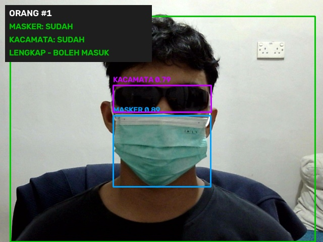 |

*Gambar 8.1 Tampilan hasil deteksi di Raspberry Pi untuk empat kondisi uji. Pada kondisi lengkap, status ditampilkan hijau ("LENGKAP - BOLEH MASUK"); pada kondisi tanpa APD, status ditampilkan merah ("APD BELUM LENGKAP").*

**Pembahasan.**

1. **Kasus yang dulu gagal sudah teratasi.** Kacamata hitam yang dipakai bersama masker terdeteksi benar (kacamata 0.79, masker 0.89 pada foto uji). Ini sesuai tujuan penambahan foto sendiri ke data latih.
2. **Kecepatan sekitar 5 FPS** pada Raspberry Pi 5 untuk pipeline pose + detektor APD dengan model PyTorch (`.pt`). Angka ini cukup untuk pemeriksaan di pintu masuk (orang berdiri diam di depan kamera), tetapi belum nyaman untuk video mengalir. Ekspor ke NCNN ([bagian 9.8](#98-opsional-ekspor-ncnn-dan-jalankan-di-raspberry-pi)) adalah langkah berikutnya untuk menaikkan FPS.
3. **E3 dilatih di `imgsz=640` tetapi dijalankan di 320** pada potongan wajah. Hasil tetap benar pada uji ini, tetapi kombinasi ukuran lain belum dibandingkan.

**Batasan uji ini:**

- Hanya **satu orang, satu sesi, dan satu latar**, dengan 100 frame per kondisi yang berurutan. Frame berurutan hampir identik, sehingga angka 100% tidak berarti peluang salah deteksi nol pada kondisi lain.
- Hanya item **`mask` dan `glasses`** yang diuji; **`gloves` belum diuji** di Pi.
- Pencahayaan, jarak, sudut wajah, dan lebih dari satu orang belum divariasikan.
- Skrip penguji yang menghasilkan berkas ini belum ada di folder `kode/`. Tambahkan jika ingin pengujian dapat diulang.

### 8.2 Pengembangan lanjutan

- Menambah foto sarung tangan dan foto di pencahayaan serta latar berbeda ke data test, lalu mengujinya juga di Raspberry Pi.
- Menguji dengan lebih banyak orang, jarak, dan sudut wajah.
- Melatih lebih dari 30 epoch dengan beberapa seed.
- Mengekspor model ke NCNN dan membandingkan FPS-nya dengan hasil 5,0 FPS di atas.

---

## 9. Cara Menjalankan Ulang

### 9.1 Prasyarat

| Kebutuhan | Keterangan |
|-----------|------------|
| Python | 3.9 atau lebih baru |
| GPU | Disarankan (hasil di README ini memakai Tesla T4 di Google Colab) |
| Paket | `ultralytics` dan `lapx` (lihat `kode/requirements.txt`) |
| Raspberry Pi OS | `opencv` dan `picamera2` sebaiknya dari `apt`, bukan `pip` |

### 9.2 Siapkan lingkungan

```bash
# 1) Salin repositori dan masuk ke foldernya
git clone https://github.com/Aidilrajinbelajar/PJ1-RET-503.git
cd PJ1-RET-503

# 2) Buat dan aktifkan virtual environment
python3 -m venv .venv
source .venv/bin/activate          # Windows: .venv\Scripts\activate

# 3) Pasang dependensi
pip install -r kode/requirements.txt
```

| Perintah | Fungsi | Hasil yang diharapkan |
|----------|--------|-----------------------|
| `git clone ...` | Mengunduh seluruh repositori | Folder `PJ1-RET-503/` terbentuk |
| `python3 -m venv .venv` | Membuat lingkungan Python terisolasi | Folder `.venv/` terbentuk |
| `pip install -r kode/requirements.txt` | Memasang `ultralytics` dan `lapx` | Paket terpasang tanpa galat |

### 9.3 Ambil dan beri label data sendiri (Tahap 1–2)

```bash
# Ambil foto dari webcam: otomatis tiap 1 detik, penanda kondisi masuk ke nama file
python kode/collect_data.py --source 0 --out dataset_raw --tag masker_saja --auto 1

# Beri label kotak (mask, glasses, gloves); file .txt disimpan di folder yang sama
python kode/label_tool.py --dir dataset_raw
```

| Perintah | Fungsi |
|----------|--------|
| `collect_data.py --source 0` | Mengambil gambar dari webcam indeks 0 (`--auto N` = simpan tiap N detik; tanpa itu, tekan SPASI) |
| `--tag` | Penanda kondisi (mis. `masker_saja`, `kacamata_saja`, `kacamata_hitam_masker`, `tanpa_apd`) |
| `label_tool.py --dir` | Membuka alat pelabelan YOLO untuk semua foto di folder |

### 9.4 Susun dataset

Data publik **tidak ada di repositori**. Unduh dan ekstrak sendiri dari Hugging Face (`Nexus3/yolov8n-ppe-detection-6classes`), lalu:

```bash
# 1) Petakan kelas dataset publik ke 3 kelas kita (kelas lain dibuang)
python kode/remap_public.py --src <folder_hasil_ekstrak_zip> --out public_remapped

# 2) Bagi foto sendiri menjadi train/val/test (berurutan menurut waktu) + tambahkan data publik ke train
python kode/make_dataset.py --src dataset_raw --out dataset \
    --names mask glasses gloves --public public_remapped
```

`make_dataset.py` menulis `dataset/data.yaml` dan statistik pembagian. Contoh hasil dengan foto sendiri saja ada di `data_projek/dataset_sendiri/` (`data.yaml` dan `dataset_stats.txt`).

> **Catatan:** pengulangan foto sendiri 10× dan penyusunan `data_gabungan.yaml` (val = 40 foto sendiri + 804 publik) dibuat saat percobaan di Colab. Lihat `kode/make_dataset.py --help` untuk opsi yang tersedia.

### 9.5 Latih dan bandingkan E1–E3 (Tahap 3)

```bash
python kode/latih_bandingkan.py \
  --nim "Cluster 7" \
  --nama "Cluster 7" \
  --data data_gabungan.yaml \
  --out hasil_praktik \
  --epochs 30
```

| Argumen | Fungsi | Nilai pada hasil di README ini |
|---------|--------|--------------------------------|
| `--nim`, `--nama` | Identitas; `--nim` dipakai untuk nama berkas `hasil_praktik_<nim>.txt/.csv` | `Cluster 7` |
| `--data` | Berkas YAML dataset | `data_gabungan.yaml` |
| `--out` | Folder keluaran eksperimen | `hasil_praktik` |
| `--epochs` | Jumlah epoch | 30 |
| `--imgsz` | Ukuran input E1 dan E2 | 416 (bawaan) |
| `--ubah` | Satu perubahan untuk E3 (`kunci=nilai`) | `imgsz=640` (bawaan) |
| `--batch`, `--seed` | Ukuran batch dan seed | 16 dan 0 (bawaan) |
| `--model` | Nama dasar model (`yolo26n` → `.pt` dan `.yaml`) | `yolo26n` (bawaan) |

**Keluaran:**

```text
hasil_praktik_Cluster 7.txt        # ringkasan tabel E1–E3 dan hasil test
hasil_praktik_Cluster 7.csv
hasil_praktik/
├── E1_pretrained/                 # results.png, results.csv, confusion_matrix*.png, args.yaml, weights/
├── E2_scratch/
└── E3_tuning/
```

> Berkas bobot (`weights/best.pt`) **tidak ikut di repositori**; berkas itu dihasilkan saat pelatihan dan perlu disalin sendiri dari folder `hasil_praktik/`.

### 9.6 Uji model terpilih pada data test (Tahap 4–5)

Data test hanya dipakai **sekali**, pada model terbaik (E3).

```bash
yolo detect val \
  model=hasil_praktik/E3_tuning/weights/best.pt \
  data=data_gabungan.yaml \
  split=test \
  imgsz=640
```

| Bagian perintah | Fungsi |
|-----------------|--------|
| `yolo detect val` | Menghitung metrik deteksi (mAP, P, R) |
| `model=...best.pt` | Bobot terbaik hasil pelatihan E3 |
| `split=test` | Memakai 20 foto test, bukan val |
| `imgsz=640` | Sama dengan ukuran pelatihan E3 |

**Keluaran yang diharapkan:** mAP50 **0.995**, mAP50-95 **0.796**, P **1.000**, R **1.000** (mask 0.864, glasses 0.729; tanpa contoh `gloves`).

### 9.7 Jalankan tes otomatis

```bash
python -m unittest discover -s kode/tests -v
```

Perintah ini menjalankan tes pembagian dataset, geometri wajah/tangan, logika status APD, dan alat label di `kode/tests/`. Keluaran yang diharapkan adalah daftar tes berstatus `ok` dan baris akhir `OK`.

### 9.8 (Opsional) Ekspor NCNN dan jalankan di Raspberry Pi

Jalankan **di Raspberry Pi**:

```bash
# Ekspor model APD dan model pose ke NCNN (imgsz harus sama dengan saat deteksi)
python kode/export_ncnn.py best.pt --imgsz 320
python kode/export_ncnn.py yolo11n-pose.pt --imgsz 416

# Mode pintar: pose + crop wajah/tangan (disarankan)
python kode/detect_smart.py \
  --pose-model yolo11n-pose_ncnn_model \
  --ppe-model best_ncnn_model \
  --source picam

# Mode sederhana: satu model; webcam C270 = --source 0
python kode/detect.py --model best_ncnn_model --source 0 --imgsz 416
```.

| Perintah | Fungsi |
|----------|--------|
| `export_ncnn.py <bobot> --imgsz N` | Mengubah `.pt` menjadi folder `*_ncnn_model/` yang lebih cepat di CPU Pi |
| `detect_smart.py` | Pose menemukan wajah dan tangan, lalu model APD dijalankan di potongannya; status SUDAH / BELUM / TIDAK TERLIHAT / MEMERIKSA |
| `detect.py` | Satu model pada frame penuh; `--require` memilih APD wajib, `--headless` untuk SSH |
| `--source` | `picam` (kamera Pi), angka (`0` = webcam), atau path video |

FPS tampil di pojok kanan atas jendela deteksi. Penjelasan sistem lengkap: [`kode/README_sistem.md`](kode/README_sistem.md).
